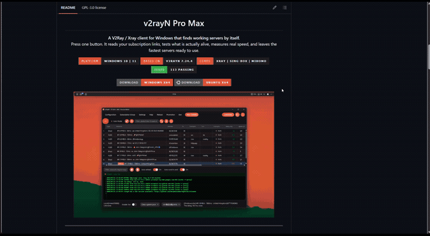
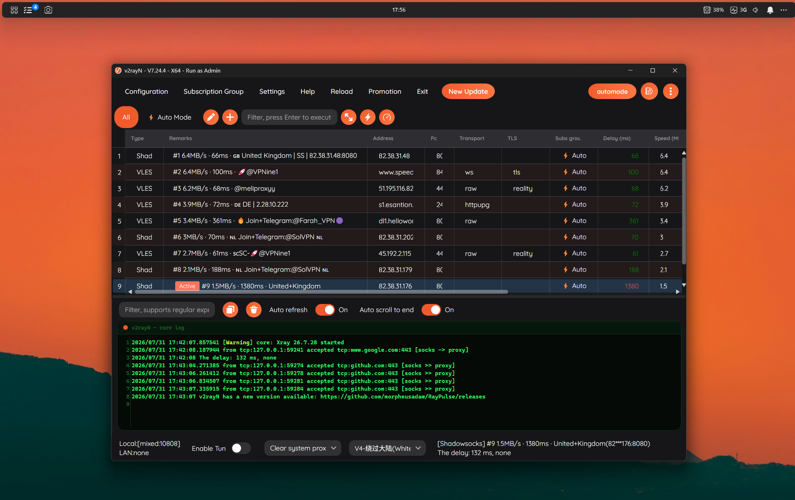
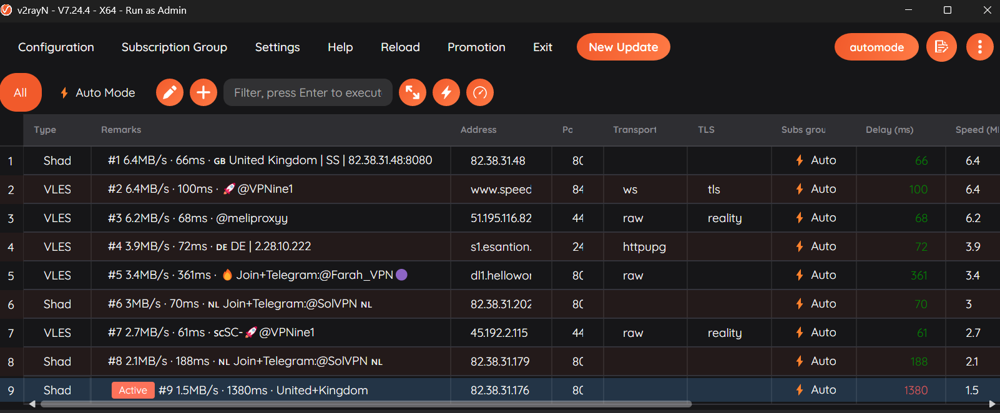
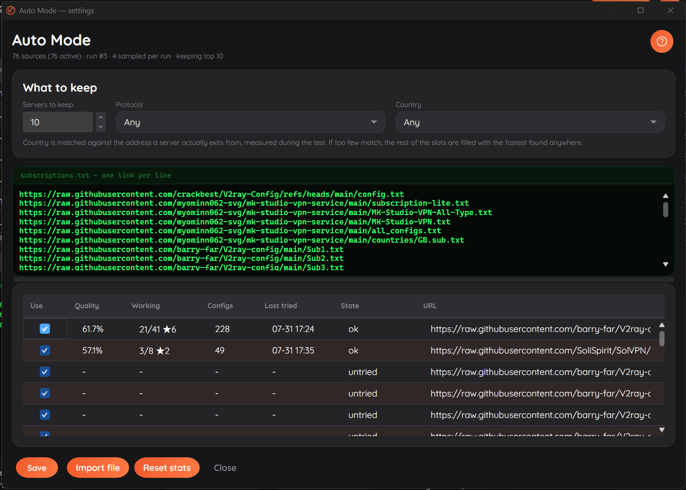

<div align="center">


<h1>v2rayN Pro Max</h1>

<p><strong>کلاینت V2Ray / Xray برای ویندوز که خودش سرور سالم پیدا می‌کند.</strong><br>
یک دکمه بزنید. لینک‌های اشتراکتان را می‌خواند، تست می‌کند کدام واقعاً زنده است، سرعت واقعی را اندازه می‌گیرد، و سریع‌ترین سرورها را آماده می‌گذارد.</p>

<p>


</p>

<p>
<a href="https://github.com/morpheusadam/v2rayN-Pro-Max/releases/latest/download/v2rayN-Pro-Max-windows-64.zip"></a>
<a href="https://github.com/morpheusadam/v2rayN-Pro-Max/releases/latest/download/v2rayN-Pro-Max-linux-64.zip"></a>
</p>



<br><br>



<br><br>

<sub><a href="README.md">English</a> · <a href="README.zh-CN.md">简体中文</a></sub>

</div>

---

## مشکلی که حل می‌کند

هر کسی که از اشتراک‌های رایگان V2Ray یا Xray استفاده می‌کند این روال را می‌شناسد. کلاینت را باز
کن. اشتراک‌ها را آپدیت کن. صبر کن. روی چند صد سرور تست پینگ بگیر. باز صبر کن. ستون را مرتب کن.
یکی را امتحان کن. مرده است. بعدی را امتحان کن. روی هر چه زنده ماند تست سرعت بگیر. یکی را انتخاب کن.

فردا آن‌هایی که خوب بودند از کار افتاده‌اند و همه‌اش را از اول انجام می‌دهی.

این یعنی هفته‌ای یک ساعت وقت صرف کاری که کامپیوتر باید انجامش بدهد. **Auto Mode این کار را با یک
فشار دکمه انجام می‌دهد**، و همین‌طور ادامه می‌دهد — پس همیشه یک فهرست کوتاه از سرورهایی داری که
چند دقیقه پیش تأیید شده‌اند، نه یک فهرست بلند که هفته‌ی پیش درست بود.

---

## Auto Mode

<div align="center">

</div>

<br>

یک فشار، کل زنجیره را اجرا می‌کند:

| مرحله | چه اتفاقی می‌افتد |
|---|---|
| **نمونه‌برداری** | چند تا از لینک‌های اشتراکت را برمی‌دارد، با اولویت آن‌هایی که قبلاً سرور سالم داده‌اند |
| **دانلود** | موازی دانلود می‌کند و هر قالبی را پارس می‌کند: متن ساده، base64، ده اسکیم URI، Clash YAML، SIP008 |
| **فیلتر** | فقط پروتکل‌ها و کشورهایی که خواسته‌ای را نگه می‌دارد، اگر چیزی خواسته باشی |
| **دسترس‌پذیری** | مقصدهایی که اصلاً جواب نمی‌دهند را کنار می‌گذارد |
| **تست تونل** | یک درخواست واقعی از دل هر سرور می‌فرستد — تنها راه فهمیدن اینکه کار می‌کند |
| **تست سرعت** | پهنای باند واقعی بازمانده‌ها را اندازه می‌گیرد |
| **نگه‌داشتن** | سریع‌ترین‌ها را در گروه خودشان می‌نویسد و فهرست قبلی را جایگزین می‌کند |

دکمه حین اجرا شمارش معکوس زنده نشان می‌دهد، تا بدانی منتظر بمانی یا بروی سراغ کارت.

### هرچه بیشتر استفاده کنی بهتر می‌شود

لینک‌های اشتراک رایگان فرسوده می‌شوند. لینکی که ماه پیش عالی بود ساکت می‌شود، آپدیت را قطع
می‌کند، یا کلاً می‌میرد. Auto Mode کارنامه‌ی هر لینک را نگه می‌دارد و خودش را تنظیم می‌کند:

- لینک‌هایی که مدام سرور سالم می‌دهند بیشتر نمونه‌برداری می‌شوند
- لینک‌هایی که دیگر چیزی نمی‌دهند کمتر، و در نهایت کنار گذاشته می‌شوند
- لینک‌های کنارگذاشته‌شده هر از گاهی دوباره امتحان می‌شوند، چون منابع رایگان به همان اندازه که ناپدید می‌شوند برمی‌گردند
- شواهد به مرور کم‌رنگ می‌شوند، پس اعتبار سه ماه پیشِ یک لینک تصمیم امروز را نمی‌گیرد

زیر پوسته، یک نمونه‌بردار Thompson با فراموشی روی منابع توست. در عمل یعنی می‌توانی هزار لینک
پیست کنی، دیگر هرگز دستی مرتبشان نکنی، و کلاینت خودش بفهمد کدام‌ها ارزش وقتش را دارند.

### سرورها جایشان را فقط با لیاقت نگه می‌دارند

هر اجرا، سرورهایی که از قبل در فهرستت هستند را کنار کاندیداهای جدید دوباره تست می‌کند. سروری که
دیروز سریع‌ترین بود و از آن موقع افت کرده، جایش را به چیز بهتری می‌دهد. در تست، ضعیف‌ترین
عضو فهرست طی دو اجرا از ۰.۲MB/s به ۱.۲MB/s رسید، صرفاً چون هر جایگاه باید دوباره فتح شود.

---

## تنظیمات

<div align="center">

</div>

<br>

**منابع.** هر تعداد لینک که خواستی، هر خط یکی. هر چیزی که لینک http نباشد نادیده گرفته می‌شود، پس
پیست کردن مستقیم از یک کانال یا یک README بدون تمیزکاری قبلی کار می‌کند. لینک‌های `blob` گیت‌هاب
خودکار به شکل raw تبدیل می‌شوند.

**چند تا نگه داشته شود.** از ۱ تا ۵۰ سرور.

**پروتکل.** VLESS، VMess، Trojan، Shadowsocks، Hysteria2، TUIC، WireGuard، AnyTLS، Naive،
SOCKS. هیچ‌کدام را تیک نزنی یعنی همه.

**کشور.** با آدرسی که سرور *واقعاً از آن خارج می‌شود* تطبیق داده می‌شود — اندازه‌گیری‌شده حین
تست، نه هر چیزی که ارائه‌دهنده در اسمش نوشته. برچسب ارائه‌دهنده فقط برای تصمیم‌گیری درباره‌ی
اینکه چه چیزی اول ارزش تست دارد استفاده می‌شود. اگر سرورهای منطبق کم باشند، جاهای باقی‌مانده با
سریع‌ترین‌های پیداشده در هر جای دیگر پر می‌شوند، به‌جای اینکه فهرستی نیمه‌خالی تحویلت بدهد.

**آمار هر منبع.** کیفیت، اینکه چند تا از سرورهایش کار کرده‌اند، چند کانفیگ دارد، آخرین بار کِی
امتحان شده، و وضعیت فعلی‌اش. تیک یک لینک را بردار تا از اجراهای بعدی کنار بماند بدون اینکه حذف
شود و تاریخچه‌اش از دست برود.

---

## چه فرقی با v2rayN اصلی دارد

این یک فورک از [2dust/v2rayN](https://github.com/2dust/v2rayN) نسخه‌ی ۷.۲۴.۴ است. هر کاری که
نسخه‌ی اصلی می‌کند، همچنان می‌کند. علاوه بر آن:

### Auto Mode

همان قابلیتی که بالا توضیح داده شد. v2rayN اصلی می‌تواند اشتراک را آپدیت کند و تست بگیرد، ولی
هر قدم را تو هدایت می‌کنی و تو تصمیم می‌گیری نتیجه یعنی چه. اینجا یک دکمه است و یک فهرست کوتاه از
سرورهای تأییدشده.

### رفع یک باگ قدیمی در تست

هر کسی که در v2rayN هزار سرور را انتخاب کرده و real ping زده نتیجه را می‌داند: تک‌تکشان ‎-1‎
برمی‌گردند. پنجاه‌تا پنجاه‌تا تست کنی درست کار می‌کند. این مشکل سال‌هاست وجود دارد و معمولاً
گردن هسته می‌افتد که تحمل این حجم را ندارد.

این‌طور نیست. اندازه‌گیری‌شده روی یک استخر اشتراک واقعی: Xray بدون هیچ اعتراضی ۹۹۲ outbound را
می‌پذیرد و ظرف یک ثانیه تمام پورت‌هایش گوش می‌دهند. علت واقعی این است که Xray جدید گزینه‌ی
`allowInsecure` را حذف کرده و **اگر حتی یک سرور در فایل هنوز آن فلگ را داشته باشد، کل فایل
پیکربندی را رد می‌کند**. فهرست‌های اشتراک رایگان پر از چنین سرورهایی هستند. اینکه یکی از آن‌ها در
دسته‌ای هزارتایی باشد تقریباً قطعی است، و ۹۹۹ تای دیگر را هم با خودش پایین می‌کشد.

دو اصلاح:

۱. این گزینه دیگر در پیکربندی‌های تولیدشده نوشته نمی‌شود، که علت را از بین می‌برد.
۲. پیش از شروع هر دسته، پیکربندی توسط خود هسته اعتبارسنجی می‌شود. اگر هسته سروری را رد کند،
   همان یک سرور از روی متن خطا شناسایی و حذف می‌شود و دسته ادامه پیدا می‌کند. اعتبارسنجی هزار
   سرور کمتر از یک‌سوم ثانیه طول می‌کشد و اصلاً به شبکه نیاز ندارد — به‌مراتب ارزان‌تر از رفتار
   پیش‌فرض که دسته را مدام نصف می‌کند و هسته‌های واقعی را دوباره راه می‌اندازد تا مقصر پیدا شود.

پیش از اصلاح، یک دسته‌ی ۱۲۰ سروری صفر سرور سالم برمی‌گرداند. بعد از آن، همان دسته ۳۶ تا داد.

### همزمانی کنترل‌شده در تست

تست‌های پینگ موج‌به‌موج اجرا می‌شوند نه همه با هم، پس نتایج به‌محض رسیدن ظاهر می‌شوند نه یکجا در
انتها، و یک دسته‌ی بزرگ دیگر thread pool را قحطی‌زده نمی‌کند.

### رابط کاربری بازسازی‌شده

- یک رنگ تأکید واحد، هندسه‌ی گرد، و یک فونت یکدست در تمام پنجره‌ها
- فهرست سرورها راحت‌تر خوانده می‌شود: ردیف‌های بلندتر، سایه‌زنی یک‌درمیان، تأخیر با رنگ‌بندی
- پنل لاگ یک کنسول واقعی است، با فونت مونواسپیس، شماره‌ی خط و خروجی سبز روی مشکی
- نوار وضعیت گروه‌بندی و برچسب‌گذاری شده، به‌جای ردیفی از کنترل‌های بی‌توضیح
- یک تم تیره‌ی یکدست، به‌جای انتخابگر تمی که فقط نصفه اعمال می‌شد

### شخصی‌سازی‌هایت باقی می‌مانند

آپدیت خودکار برنامه عمداً خاموش است. آپدیت، فایل اجرایی و اسمبلی‌ها را جایگزین می‌کند، که این
build را بی‌سروصدا به نسخه‌ی اصلی برمی‌گرداند و تنظیماتت را کنار برنامه‌ای رها می‌کند که دیگر
آن‌ها را نمی‌فهمد.

هسته‌های پروکسی موضوع جدایی هستند و عادی آپدیت می‌شوند. Xray، sing-box، mihomo و فایل‌های قوانین
geo همگی از مخازن خودشان به‌روز می‌شوند، که همان‌جایی است که اصلاحات مهم می‌رسند. برای بردن خود
برنامه به نسخه‌ی جدیدتر، از سورس دوباره build کن.

---

## نصب

| پلتفرم | دانلود |
|---|---|
| ویندوز ۱۰ / ۱۱، x64 | [v2rayN-Pro-Max-windows-64.zip](https://github.com/morpheusadam/v2rayN-Pro-Max/releases/latest/download/v2rayN-Pro-Max-windows-64.zip) |
| اوبونتو و مشتقاتش، x64 | [v2rayN-Pro-Max-linux-64.zip](https://github.com/morpheusadam/v2rayN-Pro-Max/releases/latest/download/v2rayN-Pro-Max-linux-64.zip) |

هر دو self-contained هستند، پس به .NET runtime نیاز نیست، و هر دو هسته‌های پروکسی و فایل‌های
قوانین geo را در پوشه‌ی `bin` داخل آرشیو دارند. حجم زیاد آرشیوها دقیقاً به همین دلیل است —
هیچ چیزی لازم نیست قبل از اولین تست دانلود شود.

۱. آرشیو را هر جا خواستی استخراج کن، به شرطی که پوشه‌ی `bin` کنار فایل اجرایی بماند
۲. `v2rayN.exe` را اجرا کن، یا روی لینوکس `chmod +x ./v2rayN` و بعد `./v2rayN`
۳. تنظیمات Auto Mode را با چرخ‌دنده‌ی کنار دکمه‌ی automode باز کن
۴. لینک‌های اشتراکت را پیست کن، یا [`sub.example.txt`](sub.example.txt) را که داخل آرشیو هست وارد کن
۵. دکمه‌ی **automode** را بزن و چند دقیقه صبر کن

هسته‌های جدیدتر را بعداً می‌شود از **Help ← Check Update** گرفت؛ خود برنامه عمداً آپدیت خودکار
ندارد.

یک اجرا سه تا پنج دقیقه طول می‌کشد، بسته به اینکه چند لینک داری و چقدر سالم‌اند، حین کار حدود
چهارده درصد از یک هسته‌ی پردازنده مصرف می‌کند، و بعدش حافظه به حالت عادی برمی‌گردد.

`sub.example.txt` با ۷۶ لینک اشتراک عمومی می‌آید تا چیزی برای شروع باشد. هیچ‌کدامشان توسط این
پروژه اداره نمی‌شوند.

---

## build از سورس

```
git clone https://github.com/morpheusadam/v2rayN-Pro-Max.git
cd v2rayN-Pro-Max/v2rayN
dotnet build v2rayN.Desktop/v2rayN.Desktop.csproj -c Release
```

به **‏.NET 10 SDK** نیاز دارد. دو فرانت‌اند ویندوزی داخلش هست که تمام منطق را مشترکاً استفاده
می‌کنند: `v2rayN.Desktop` (‏Avalonia، همانی که در release‌ها منتشر می‌شود) و `v2rayN` (‏WPF).

اجرای تست‌ها:

```
dotnet test ServiceLib.Tests/ServiceLib.Tests.csproj
```

ساخت دوباره‌ی آیکن‌ها بعد از جایگزینی `tools/logo-source.png`:

```
python tools/make_icons.py
```

ساخت آرشیوهای release (هسته‌ها را هم داخلشان می‌گذارد):

```
pwsh -File tools/package-release.ps1
```

---

## Auto Mode دقیقاً چطور تصمیم می‌گیرد

اعداد پشت این طراحی در [docs/automode-design.md](docs/automode-design.md) هستند. دو یافته از
اندازه‌گیری یک استخر اشتراک واقعی شکلش دادند.

**دسترس‌پذیری تقریباً هیچ معنایی ندارد.** هشتاد درصد مقصدها اتصال TCP را قبول می‌کنند. پنج درصد
واقعاً ترافیک عبور می‌دهند. باز بودن یک پورت هیچ چیزی درباره‌ی کار کردن پروکسی پشتش نمی‌گوید، پس
دسترس‌پذیری فقط و فقط برای کنار گذاشتن کاملاً مرده‌ها استفاده می‌شود.

**مرتب کردن کاندیداها بر اساس کمترین پینگ، بدتر از مرتب نکردن است.** ۲.۱ درصد از کاندیداهای
کم‌تأخیرترین کار کردند، در برابر ۷.۵ درصد از یک انتخاب تصادفی از همان استخر. میزبان‌هایی که
سریع‌ترین جواب را می‌دهند لبه‌های CDN هستند که هر اتصالی را تأیید می‌کنند در حالی که پروکسی پشتشان
مدت‌هاست از بین رفته. بنابراین تأخیر هرگز برای رتبه‌بندی کاندیداها استفاده نمی‌شود، فقط برای دور
انداختن غیرقابل‌دسترس‌ها.

---

## اعتبارها و مجوز

ساخته‌شده روی [2dust/v2rayN](https://github.com/2dust/v2rayN)، که کار سخت پشتیبانی از تمام
پروتکل‌ها، هسته‌ها و ترنسپورت‌ها را انجام می‌دهد. هسته‌ها از
[XTLS/Xray-core](https://github.com/XTLS/Xray-core)،
[SagerNet/sing-box](https://github.com/SagerNet/sing-box) و
[MetaCubeX/mihomo](https://github.com/MetaCubeX/mihomo). رابط کاربری با
[Avalonia](https://avaloniaui.net) و [Semi.Avalonia](https://github.com/irihitech/Semi.Avalonia).

تحت مجوز GPL-3.0، همان مجوز نسخه‌ی اصلی.

### یک نکته درباره‌ی لینک‌های اشتراک

لینک‌های داخل `sub.example.txt` فهرست‌های عمومی‌اند که از گیت‌هاب و کانال‌های عمومی جمع‌آوری
شده‌اند. توسط این پروژه اداره، تأیید یا راستی‌آزمایی نمی‌شوند، و محتوایشان بدون اطلاع قبلی تغییر
می‌کند. Auto Mode آن‌ها را اندازه می‌گیرد به‌جای اینکه به آن‌ها اعتماد کند، که اتفاقاً کل ماجرا
همین است. برای هر چیزی که برایت مهم است از سرورهایی استفاده کن که به آن‌ها اعتماد داری.

<div align="center">
<br>
<sub>ساخته‌شده برای کسانی که ترجیح می‌دهند از اینترنت استفاده کنند تا اینکه هفته‌ای یک ساعت پروکسی تست کنند.</sub>
</div>
