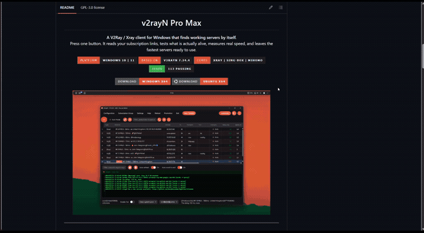
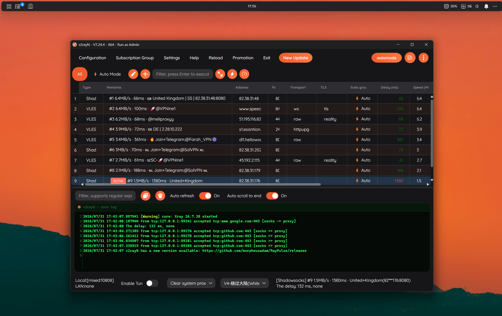
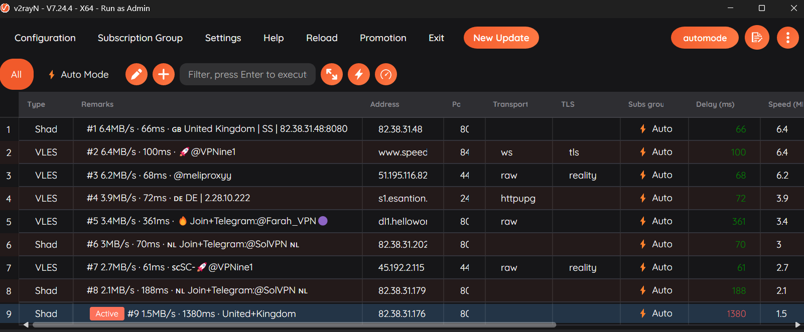
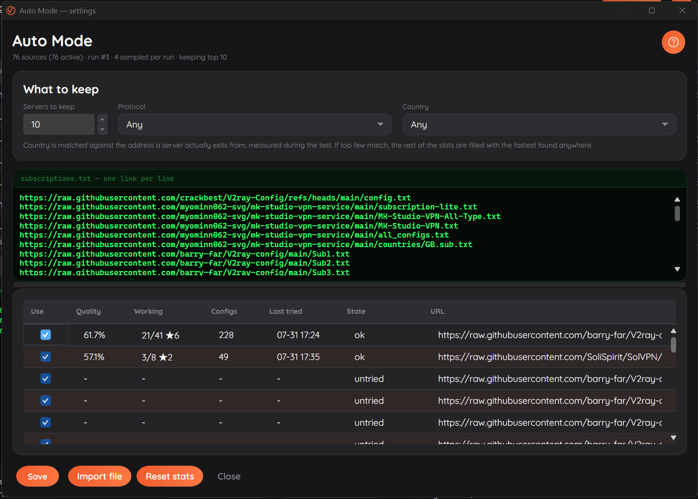

# v2rayN Pro Max

v2rayN Pro Max is a V2Ray / Xray client for Windows and Linux, for people who use free subscription links and would rather have the client test and pick working servers than do it by hand.

<div align="center">


<p>Press one button. It reads your subscription links, tests what is actually alive, measures real speed, and leaves the fastest servers ready to use.</p>

<p>


</p>

<p>
<a href="https://github.com/morpheusadam/v2rayN-Pro-Max/releases/latest/download/v2rayN-Pro-Max-windows-64.zip"></a>
<a href="https://github.com/morpheusadam/v2rayN-Pro-Max/releases/latest/download/v2rayN-Pro-Max-linux-64.zip"></a>
</p>



<br><br>



<br><br>

<sub><a href="README.fa.md">فارسی</a> · <a href="README.zh-CN.md">简体中文</a></sub>

</div>

---

## The problem this solves

Anyone using free V2Ray or Xray subscriptions knows the routine. Open the client. Update the
subscriptions. Wait. Run a ping test on a few hundred servers. Wait again. Sort the column.
Try one. It is dead. Try the next. Run a speed test on whatever survived. Pick one.

Tomorrow the good ones have stopped working and you do it all over again.

That is an hour a week spent doing something a computer should be doing. **Auto Mode does it
in one press**, and it keeps doing it, so you always have a short list of servers that were
verified minutes ago rather than a long list that was true last week.

---

## Auto Mode

<div align="center">

</div>

<br>

One press runs the whole pipeline:

| Stage | What happens |
|---|---|
| **Sample** | Picks a handful of your subscription links, favouring the ones that have produced working servers before |
| **Fetch** | Downloads them in parallel and parses every format: plain text, base64, ten URI schemes, Clash YAML, SIP008 |
| **Filter** | Keeps only the protocols and countries you asked for, if you asked for any |
| **Reachability** | Drops endpoints that answer nothing |
| **Tunnel test** | Sends a real request through each server, which is the only way to know it works |
| **Speed test** | Measures actual throughput on the survivors |
| **Keep** | Writes the fastest into their own group, replacing the previous list |

The button shows a live countdown while it runs, so you know whether to wait or walk away.

### It gets better the more you use it

Free subscription links decay. A link that was excellent last month goes quiet, stops
updating, or dies outright. Auto Mode tracks each link's record and adjusts:

- Links that keep producing working servers get sampled more often
- Links that stop producing get sampled less, and are eventually parked
- Parked links still get an occasional retry, because free sources come back as often as they vanish
- Evidence fades over time, so a link's reputation from three months ago does not decide today's run

Underneath it is a decayed Thompson sampler over your sources. In practice it means you can
paste a thousand links, never curate them again, and the client works out which ones deserve
its time.

### Servers keep their place only by earning it

Every run re-tests the servers already in your list alongside the new candidates. A server
that was fastest yesterday and has since degraded loses its slot to something better. In
testing, the weakest entry in the list went from 0.2 MB/s to 1.2 MB/s across two runs, purely
because every slot has to be re-won.

---

## Settings

<div align="center">

</div>

<br>

**Sources.** Paste as many links as you like, one per line. Anything that is not an http link
is ignored, so pasting straight from a channel or a README works without cleaning it up first.
GitHub `blob` links are rewritten to their raw form automatically.

**How many to keep.** Anywhere from 1 to 50 servers.

**Protocol.** VLESS, VMess, Trojan, Shadowsocks, Hysteria2, TUIC, WireGuard, AnyTLS, Naive,
SOCKS. Tick none for any.

**Country.** Matched against the address a server *actually exits from*, measured during the
test, rather than whatever the provider wrote in its name. Provider labels are only used to
decide what is worth testing first. If too few servers match, the remaining slots are filled
with the fastest found anywhere rather than handing you a half-empty list.

**Per-source statistics.** Quality, how many of its servers worked, how many configs it
carries, when it was last tried, and its current state. Untick a link to leave it out of
future runs without deleting it and losing its history.

---

## What is different from stock v2rayN

This is a fork of [2dust/v2rayN](https://github.com/2dust/v2rayN) 7.24.4. Everything the
original does, it still does. On top of that:

### Auto Mode

The whole feature above. Stock v2rayN can update subscriptions and run tests, but you drive
every step and you decide what the results mean. Here it is one button and a short list of
verified servers.

### A long-standing test bug, fixed

Anyone who has selected a thousand servers in v2rayN and pressed real ping knows the result:
every single one comes back as -1. Test fifty at a time and it works fine. This has been
around for years and is usually blamed on the core being unable to cope with the load.

It is not. Measured against a real subscription pool: Xray accepts 992 outbounds without
complaint, and every one of its ports is listening within a second. The actual cause is that
recent Xray removed the `allowInsecure` option and **rejects the entire configuration file if
any single server in it still sets that flag**. Free subscription lists are full of such
servers. One of them appearing in a batch of a thousand is close to certain, and it takes the
other 999 down with it.

Two fixes:

1. The option is no longer written into generated configurations, which removes the cause.
2. Before a batch starts, the configuration is validated by the core itself. If the core
   rejects a server, that one server is identified from the error message and dropped, and the
   batch proceeds. Validating a thousand servers takes under a third of a second and needs no
   network at all — far cheaper than the stock behaviour of repeatedly halving the batch and
   restarting real cores until the culprit is found.

Before the fix, a 120-server batch returned 0 working. After it, the same batch returned 36.

### Bounded test concurrency

Ping tests run in waves rather than all at once, so results appear as they arrive instead of
in one burst at the end, and a large batch no longer starves the thread pool.

### A rebuilt interface

- A single accent colour, rounded geometry and one consistent typeface across every window
- The server list is easier to scan: taller rows, alternating shading, colour-coded latency
- The log panel is a proper console, with a monospace face, line numbers and green-on-black output
- A grouped, labelled status bar instead of a row of unexplained controls
- One dark theme, styled throughout, rather than a theme picker that only half applies

### Your customisations survive

Application self-update is deliberately disabled. An update replaces the executable and its
assemblies, which would silently revert this build to stock upstream and leave your settings
sitting there beside an application that no longer understands them.

The proxy cores are a separate matter and keep updating normally. Xray, sing-box, mihomo and
the geo rule files all continue to update from their own upstream repositories, which is where
the fixes that actually matter arrive. To move the app itself to a newer version, rebuild from
source.

---

## Install

| Platform | Download |
|---|---|
| Windows 10 / 11, x64 | [v2rayN-Pro-Max-windows-64.zip](https://github.com/morpheusadam/v2rayN-Pro-Max/releases/latest/download/v2rayN-Pro-Max-windows-64.zip) |
| Ubuntu and derivatives, x64 | [v2rayN-Pro-Max-linux-64.zip](https://github.com/morpheusadam/v2rayN-Pro-Max/releases/latest/download/v2rayN-Pro-Max-linux-64.zip) |

Both are self-contained, so no .NET runtime is required, and both ship the proxy cores and
geo rule files in a `bin` folder inside the archive. That is what makes the archives large —
nothing has to be downloaded before the first test can run.

1. Extract the archive anywhere, keeping the `bin` folder beside the executable
2. Run `v2rayN.exe`, or on Linux `chmod +x ./v2rayN` and then `./v2rayN`
3. Open Auto Mode settings with the gear beside the automode button
4. Paste your subscription links, or import [`sub.example.txt`](sub.example.txt), which ships in the archive
5. Press **automode** and wait a few minutes

Newer cores can be fetched later from **Help → Check Update**; the app itself does not
self-update, on purpose.

A run takes three to five minutes depending on how many links you have and how healthy they
are, uses roughly fourteen percent of one core while it works, and settles back to normal
memory afterwards.

`sub.example.txt` ships with 76 public subscription links so there is something to start with.
None of them are operated by this project.

---

## Build from source

```
git clone https://github.com/morpheusadam/v2rayN-Pro-Max.git
cd v2rayN-Pro-Max/v2rayN
dotnet build v2rayN.Desktop/v2rayN.Desktop.csproj -c Release
```

Requires the **.NET 10 SDK**. Two Windows front ends are included and share all of the logic:
`v2rayN.Desktop` (Avalonia, the one the releases ship) and `v2rayN` (WPF).

Run the tests:

```
dotnet test ServiceLib.Tests/ServiceLib.Tests.csproj
```

Regenerate the icons after replacing `tools/logo-source.png`:

```
python tools/make_icons.py
```

---

## How Auto Mode decides, in detail

The numbers behind the design are in [docs/automode-design.md](docs/automode-design.md). Two
findings from measuring a real subscription pool shaped it.

**Reachability means almost nothing.** Eighty percent of endpoints accept a TCP connection.
Five percent actually carry traffic. A port being open says nothing about whether the proxy
behind it works, so reachability is only ever used to drop the completely dead.

**Sorting candidates by lowest ping is worse than not sorting at all.** 2.1 percent of the
lowest-latency candidates worked, against 7.5 percent of a random selection from the same
pool. The fastest-answering hosts are CDN edges that acknowledge any connection while the
proxy behind them is long gone. Latency is therefore never used to rank candidates, only to
discard the unreachable.

---

## Credits and licence

Built on [2dust/v2rayN](https://github.com/2dust/v2rayN), which does the hard work of
supporting every protocol, core and transport. Cores by
[XTLS/Xray-core](https://github.com/XTLS/Xray-core),
[SagerNet/sing-box](https://github.com/SagerNet/sing-box) and
[MetaCubeX/mihomo](https://github.com/MetaCubeX/mihomo). Interface built with
[Avalonia](https://avaloniaui.net) and [Semi.Avalonia](https://github.com/irihitech/Semi.Avalonia).

Licensed under GPL-3.0, the same as upstream.

### A note on the subscription links

The links in `sub.example.txt` are public lists collected from GitHub and public channels.
They are not operated, endorsed or verified by this project, and their contents change without
notice. Auto Mode measures them rather than trusting them, which is rather the point. Use
servers you trust for anything that matters.

<div align="center">
<br>
<sub>Built for people who would rather use the internet than spend an hour a week testing proxies.</sub>
</div>
