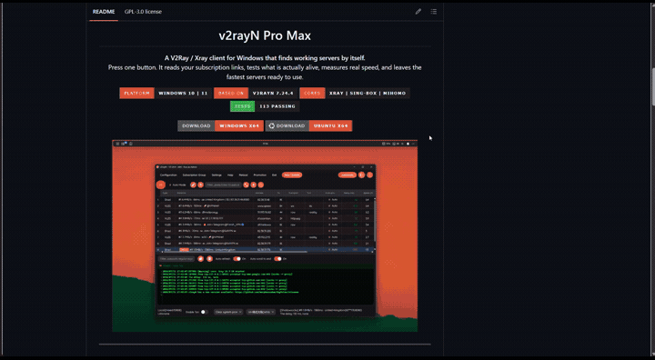
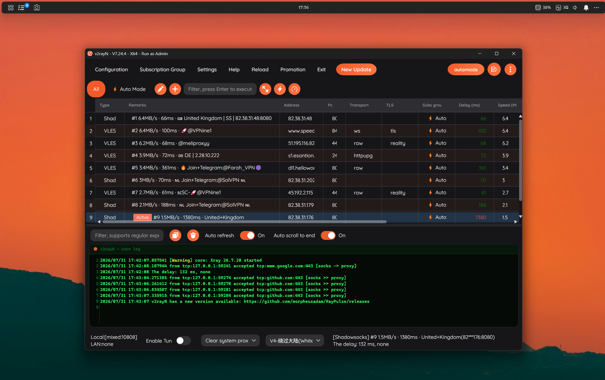
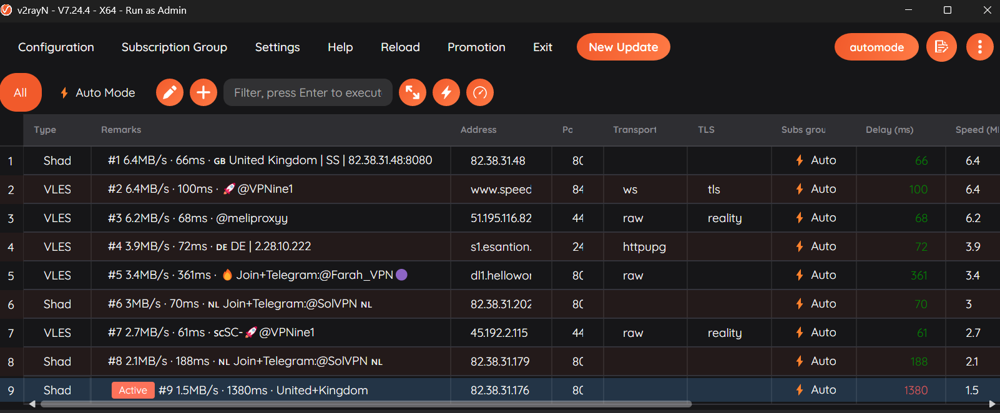
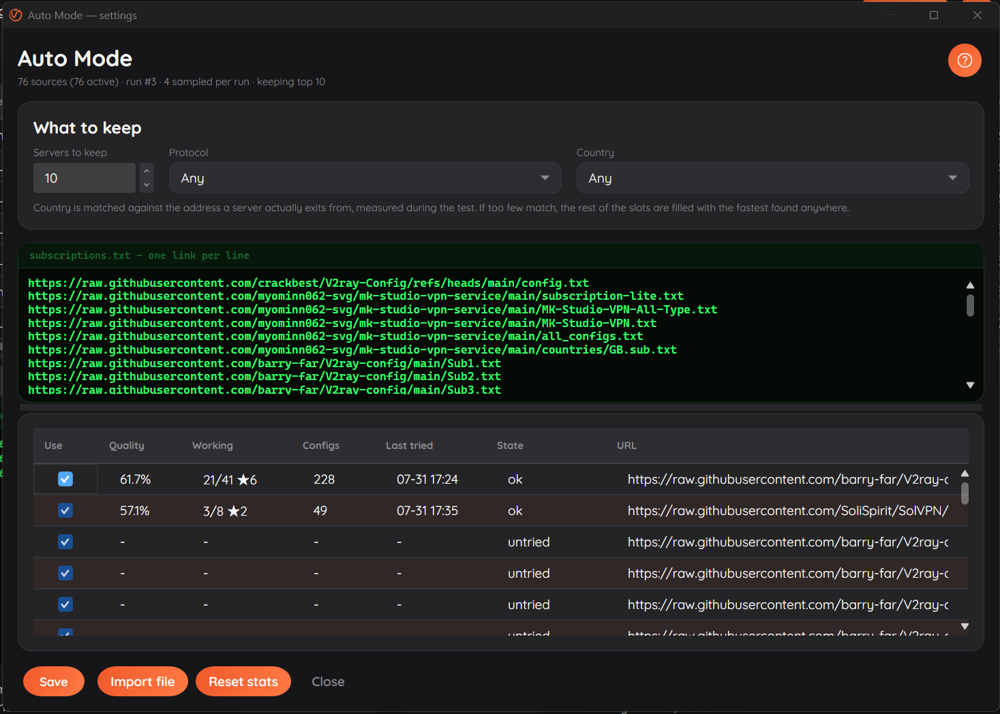

<div align="center">


<h1>v2rayN Pro Max</h1>

<p><strong>一个会自己找出可用节点的 Windows 版 V2Ray / Xray 客户端。</strong><br>
按一下按钮。它读取你的订阅链接，测出哪些真的还活着，量出真实速度，把最快的节点准备好。</p>

<p>


</p>

<p>
<a href="https://github.com/morpheusadam/v2rayN-Pro-Max/releases/latest/download/v2rayN-Pro-Max-windows-64.zip"></a>
<a href="https://github.com/morpheusadam/v2rayN-Pro-Max/releases/latest/download/v2rayN-Pro-Max-linux-64.zip"></a>
</p>



<br><br>



<br><br>

<sub><a href="README.md">English</a> · <a href="README.fa.md">فارسی</a></sub>

</div>

---

## 它解决的问题

用过免费 V2Ray 或 Xray 订阅的人都熟悉这套流程。打开客户端。更新订阅。等。对几百个节点跑一遍
延迟测试。再等。按列排序。试一个，死的。再试下一个。对活下来的跑测速。挑一个。

第二天，好用的那些不动了，于是整套再来一遍。

这是每周一小时，花在本该由电脑做的事情上。**Auto Mode 一键完成**，而且会一直做下去，所以你手上
永远是一份几分钟前刚验证过的短名单，而不是一份上周还成立的长名单。

---

## Auto Mode

<div align="center">

</div>

<br>

按一下，整条流水线跑完：

| 阶段 | 做什么 |
|---|---|
| **抽样** | 从你的订阅链接中挑几条，优先选此前产出过可用节点的 |
| **抓取** | 并行下载并解析各种格式：纯文本、base64、十种 URI scheme、Clash YAML、SIP008 |
| **过滤** | 只保留你指定的协议与国家（如果你指定了的话） |
| **可达性** | 丢掉完全没有响应的端点 |
| **隧道测试** | 通过每个节点发一个真实请求 —— 这是唯一能确认它可用的办法 |
| **测速** | 对幸存者测量实际吞吐 |
| **保留** | 把最快的写进专属分组，替换上一轮的名单 |

运行时按钮上有实时倒计时，让你知道该等还是该去忙别的。

### 用得越多，它越准

免费订阅链接会衰减。上个月还很棒的链接会安静下来、停止更新，或者干脆死掉。Auto Mode 会记录每条
链接的战绩并自我调整：

- 持续产出可用节点的链接被抽中得更频繁
- 不再产出的链接被抽中得更少，最终被搁置
- 被搁置的链接仍会偶尔重试，因为免费源消失得多，回来得也多
- 证据会随时间衰减，所以三个月前的口碑不会决定今天这一轮

底层是对订阅源做带衰减的 Thompson 采样。实际效果是：你可以粘贴一千条链接，之后再也不用整理，
客户端自己会算出哪些值得花时间。

### 节点的位置只能靠实力守住

每一轮都会把已经在名单里的节点和新候选放在一起重测。昨天最快、之后劣化的节点，会把位置让给更好的。
测试中，名单里最弱的一项在两轮之内从 0.2 MB/s 变成 1.2 MB/s，纯粹因为每个位置都得重新赢一次。

---

## 设置

<div align="center">

</div>

<br>

**订阅源。** 想放多少链接都行，一行一条。不是 http 链接的内容会被忽略，所以从频道或 README 里
直接粘贴也不用先清理。GitHub 的 `blob` 链接会自动转成 raw 形式。

**保留多少个。** 1 到 50 个节点。

**协议。** VLESS、VMess、Trojan、Shadowsocks、Hysteria2、TUIC、WireGuard、AnyTLS、Naive、
SOCKS。一个都不勾就是不限。

**国家。** 匹配的是节点*实际出口*的地址，在测试过程中实测得出，而不是服务商在名字里写的那个。
服务商的标签只用来决定先测哪些更值得。如果匹配到的节点太少，剩下的名额会用其他地方找到的最快节点
补满，而不是给你一份半空的名单。

**每个源的统计。** 质量、它的节点有多少可用、携带多少配置、上次尝试的时间，以及当前状态。取消勾选
某条链接即可让它不参与后续运行，同时不删除它、不丢失它的历史。

---

## 与原版 v2rayN 有什么不同

这是 [2dust/v2rayN](https://github.com/2dust/v2rayN) 7.24.4 的一个 fork。原版能做的它都还能做。
在此之上：

### Auto Mode

就是上面那整套功能。原版 v2rayN 也能更新订阅、也能跑测试，但每一步都得你自己推进，结果意味着什么
也得你自己判断。这里是一个按钮，外加一份验证过的短名单。

### 修掉了一个存在多年的测试 bug

在 v2rayN 里选中一千个节点然后按真连延迟测试的人都知道结果：每一个都返回 -1。一次测五十个又完全
正常。这个问题存在很多年了，通常被归咎于内核扛不住这个量。

不是的。在真实订阅池上实测：Xray 毫无怨言地接受了 992 个 outbound，而且一秒之内所有端口都在监听。
真正的原因是新版 Xray 移除了 `allowInsecure` 选项，并且**只要文件里还有任何一个节点带着这个标志，
就会拒绝整个配置文件**。免费订阅列表里全是这种节点。一千个里出现一个几乎是必然的，而它会把另外
999 个一起拖下水。

两处修复：

1. 生成配置时不再写入该选项，从源头消除病因。
2. 每批开始前，配置先由内核自己校验。如果内核拒绝了某个节点，就从错误信息里定位出那一个并剔除，
   然后这一批继续跑。校验一千个节点耗时不到三分之一秒，而且完全不需要网络 —— 远比原版那种反复
   对半拆分、反复重启真实内核直到揪出元凶的做法便宜。

修复前，一批 120 个节点返回 0 个可用。修复后，同一批返回 36 个。

### 受控的测试并发

延迟测试分波次进行而不是一次全上，所以结果是陆续出现而不是最后一次性涌出，大批量也不会再把线程池
饿死。

### 重做的界面

- 全部窗口统一的强调色、圆角几何与同一套字体
- 节点列表更好扫读：更高的行、交替底色、按颜色区分的延迟
- 日志面板是一个真正的控制台：等宽字体、行号、黑底绿字
- 分组并带标签的状态栏，取代一排没有说明的控件
- 一套通体统一的深色主题，而不是一个只生效一半的主题切换器

### 你的自定义不会被抹掉

应用自更新是特意关闭的。更新会替换可执行文件和程序集，那会悄悄把这个构建变回上游原版，同时把你的
设置留在一个已经读不懂它们的程序旁边。

代理内核是另一回事，照常更新。Xray、sing-box、mihomo 以及 geo 规则文件都继续从各自的上游仓库更新，
真正重要的修复正是从那里来的。要把应用本身升到更新的版本，请从源码重新构建。

---

## 安装

| 平台 | 下载 |
|---|---|
| Windows 10 / 11, x64 | [v2rayN-Pro-Max-windows-64.zip](https://github.com/morpheusadam/v2rayN-Pro-Max/releases/latest/download/v2rayN-Pro-Max-windows-64.zip) |
| Ubuntu 及其衍生版, x64 | [v2rayN-Pro-Max-linux-64.zip](https://github.com/morpheusadam/v2rayN-Pro-Max/releases/latest/download/v2rayN-Pro-Max-linux-64.zip) |

两者都是自包含的，不需要 .NET 运行时；两者的压缩包内都带有 `bin` 目录，里面是代理内核和 geo 规则
文件。压缩包之所以大就是因为这个 —— 第一次测试之前不需要再下载任何东西。

1. 把压缩包解压到任意位置，保持 `bin` 目录与可执行文件在一起
2. 运行 `v2rayN.exe`；Linux 上先 `chmod +x ./v2rayN`，然后 `./v2rayN`
3. 点 automode 按钮旁边的齿轮打开 Auto Mode 设置
4. 粘贴你的订阅链接，或导入压缩包内自带的 [`sub.example.txt`](sub.example.txt)
5. 按 **automode**，等几分钟

更新的内核之后可以从 **Help → Check Update** 获取；应用本身特意不做自更新。

一轮运行需要三到五分钟，取决于你有多少链接、它们有多健康；运行时约占用一个 CPU 核心的 14%，结束后
内存回落到正常水平。

`sub.example.txt` 自带 76 条公开订阅链接，让你有个起点。它们都不由本项目运营。

---

## 从源码构建

```
git clone https://github.com/morpheusadam/v2rayN-Pro-Max.git
cd v2rayN-Pro-Max/v2rayN
dotnet build v2rayN.Desktop/v2rayN.Desktop.csproj -c Release
```

需要 **.NET 10 SDK**。仓库内含两个 Windows 前端，共用全部逻辑：`v2rayN.Desktop`（Avalonia，
release 发布的就是它）和 `v2rayN`（WPF）。

运行测试：

```
dotnet test ServiceLib.Tests/ServiceLib.Tests.csproj
```

替换 `tools/logo-source.png` 后重新生成图标：

```
python tools/make_icons.py
```

打包 release 压缩包（内核会一并放进去）：

```
pwsh -File tools/package-release.ps1
```

---

## Auto Mode 具体如何决策

设计背后的数据在 [docs/automode-design.md](docs/automode-design.md)。有两个来自真实订阅池的实测
结论塑造了它。

**可达性几乎说明不了任何问题。** 八成的端点会接受 TCP 连接，只有百分之五真的能承载流量。端口开着，
并不代表它背后的代理还能用，所以可达性只被用来剔除彻底死掉的那些。

**按最低延迟给候选排序，比不排序更糟。** 延迟最低的那批候选里有 2.1% 可用，而从同一个池子里随机
选出的有 7.5% 可用。响应最快的主机往往是 CDN 边缘节点：它们对任何连接都应答，而背后的代理早就没了。
因此延迟从不用于给候选排名，只用于丢弃不可达的。

---

## 致谢与许可

构建于 [2dust/v2rayN](https://github.com/2dust/v2rayN) 之上 —— 支持全部协议、内核与传输方式这些
苦活都是它做的。内核来自
[XTLS/Xray-core](https://github.com/XTLS/Xray-core)、
[SagerNet/sing-box](https://github.com/SagerNet/sing-box) 和
[MetaCubeX/mihomo](https://github.com/MetaCubeX/mihomo)。界面使用
[Avalonia](https://avaloniaui.net) 与 [Semi.Avalonia](https://github.com/irihitech/Semi.Avalonia) 构建。

以 GPL-3.0 授权，与上游一致。

### 关于订阅链接的说明

`sub.example.txt` 里的链接是从 GitHub 和公开频道收集来的公开列表。它们不由本项目运营、背书或核实，
内容也会在不通知的情况下变化。Auto Mode 的做法是去测量它们而不是信任它们 —— 这恰恰就是重点。真正
重要的事情，请使用你信任的节点。

<div align="center">
<br>
<sub>为那些宁愿用互联网、也不愿每周花一小时测代理的人而做。</sub>
</div>
